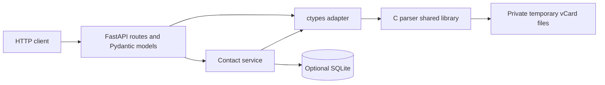
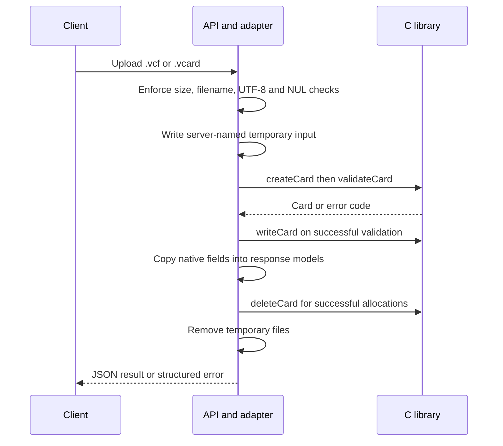

# vCard Parser Service

## Overview

A standalone FastAPI backend that modernizes an existing C/Python vCard manager. The original C parser and linked-list implementation remain the parsing engine; dedicated Python modules replace the terminal interface and remote database integration.

This is a modernization of an existing project. Third-party linked-list attribution remains in `include/LinkedListAPI.h`.

## Features

- Parse and validate uploaded vCard 4.0 files using C.
- Return names, grouped properties, parameters, dates, and serialized vCard content as JSON.
- Create contacts, list stored cards, retrieve cards, edit formatted names, and delete cards.
- Optional local SQLite persistence with transactional writes and UUID identifiers.
- Bounded uploads, private temporary files, structured errors, and generated API documentation.
- A lightweight browser workspace for uploads, contact management, and vCard downloads, served by FastAPI without a frontend build step.

The API exposes the native parser's supported subset. Input must contain one UTF-8 vCard with CRLF line endings, VERSION:4.0, and one nonempty FN. Folded lines and structured N/ADR values are supported. Logical lines must fit within 65,535 bytes including CRLF. Parsing does not claim complete RFC 6350 conformance: quoted parameter delimiters, multiple FN properties, numeric timezone offsets, and truncated time forms are unsupported. Values retain native vCard escaping. Date properties retain their date/time or text value; arbitrary date parameters and date groups are not represented by the existing C data model. Serialization normalizes ordering and unfolds lines; it does not preserve original file formatting or add recommended output line folding.

## Tech Stack

- C11 and a GCC-compatible compiler for the shared library
- Python 3.11+, ctypes, FastAPI, Pydantic, Uvicorn
- SQLite through Python's standard library
- pytest and HTTPX for tests
- Docker with a standard Python base image

## Architecture



`createCard` parses files, `validateCard` checks native cards, `updateFN` edits formatted names, `writeCard` serializes cards, and `deleteCard` releases native allocations. The adapter declares the complete struct layouts and function signatures, copies results into Python values, and frees each successfully created card in a `finally` block. Native calls share a process-local lock because the parser uses `strtok`.

SQLite stores canonical vCard content and timestamps in one table. There is no permanent upload directory or second file store to synchronize. Parsing and validation do not require a database when persistence is disabled.



## Getting Started

Run commands from the repository root. You need Python 3.11+ and GCC on PATH. Python and the compiler must target the same architecture. The local workflow was verified on Windows with Python 3.13 and MinGW GCC; the Linux build and tests were verified in Docker.

In the following commands, `python` means your installed Python executable. If your launcher is unavailable, use that executable's full path when creating the environment.

```text
python -m venv .venv
```

On Windows PowerShell:

```powershell
.venv/Scripts/python.exe -m pip install -e '.[test]'
.venv/Scripts/python.exe scripts/build_native.py
.venv/Scripts/python.exe -m uvicorn app.main:app --host 127.0.0.1 --port 8000
```

The build produces `build/vcparser.dll` on Windows or `build/libvcparser.so` on Linux. Rebuild after changing C sources, and restart the service before loading the new library. Startup fails with a build instruction if the library is missing.

Open the [contact workspace](http://127.0.0.1:8000/) to upload and inspect files, validate them, download vCards, and create, rename, or delete saved contacts. The contact list is paginated. Uploaded files remain previews; creating a saved contact uses its own name form. With persistence disabled, the workspace still supports file inspection and validation.

[API documentation](http://127.0.0.1:8000/docs) and [health](http://127.0.0.1:8000/health) are also available. The OpenAPI schema is at `/openapi.json`.

The makefile delegates to the same scripts. An explicit filename also works with Windows Make installations:

```powershell
make -f makefile parser PYTHON=.venv/Scripts/python.exe
```

## Environment Variables

| Variable | Default | Purpose |
| --- | --- | --- |
| `DATABASE_URL` | `sqlite:///data/cards.db` | SQLite file relative to the working directory; use `disabled` for parsing and validation only. Absolute SQLite paths are also accepted. |
| `VCARD_LIBRARY_PATH` | Repository `build/` library | Explicit shared-library path, required when installing the Python package away from the source checkout. |
| `MAX_UPLOAD_BYTES` | `1048576` | Maximum uploaded file size in bytes. Total request bodies are capped at this value plus 65,536 bytes for multipart overhead. |
| `CC` | `gcc` | Compiler executable used by build scripts. |
| `CFLAGS` | Empty | Additional flags for the shared-library build. |

Set variables in the process environment before starting Uvicorn. Environment files are ignored by Git but are not loaded automatically. SQLite directories are created at startup; the process needs write permission. In-memory SQLite URLs and other database engines are not supported.

## API Reference

| Method | Path | Input | Success |
| --- | --- | --- | --- |
| GET | `/health` | None | 200: native readiness and persistence mode |
| POST | `/api/v1/cards/parse` | Multipart `file` | 200: parsed card and serialized vCard; does not save |
| POST | `/api/v1/cards/validate` | Multipart `file` | 200: `{"valid": true}`; does not save |
| POST | `/api/v1/cards` | JSON `formatted_name` | 201: stored minimal card and Location header |
| GET | `/api/v1/cards` | `limit` (1?100, default 50), `offset` (default 0) | 200: stored card array |
| GET | `/api/v1/cards/{card_id}` | UUID | 200: stored card |
| PATCH | `/api/v1/cards/{card_id}` | JSON `formatted_name` | 200: updated card |
| DELETE | `/api/v1/cards/{card_id}` | UUID | 204: empty response |

Create and PATCH accept `{"formatted_name": "Jane Doe"}`. Names must be nonempty, at most 512 characters, and contain no control characters. Unknown request fields are rejected. PATCH edits only FN, matching the existing C editing function. Uploads are transient; the API does not currently import an uploaded card into persistence.

Parsed responses include `formatted_name`, `formatted_name_property`, `properties`, nullable `birthday` and `anniversary`, and `vcard`. Properties contain `name`, `group`, `parameters`, and `values`. Dates contain `date`, `time`, `text`, `is_text`, and `utc`. Stored responses add `id`, `created_at`, and `updated_at` in UTC.

Failures use a consistent envelope:

```json
{"error": {"code": "invalid_datetime", "message": "The vCard contains an invalid or unsupported date/time."}}
```

Request validation errors also contain a `details` array. Invalid cards and request fields return 422, missing cards return 404, oversized uploads return 413, unsupported filenames return 415, and disabled or unavailable persistence returns 503. Native allocation/write failures return 500. Uploaded path components are rejected; client filenames never become filesystem paths.

Supported birthday and anniversary forms include basic calendar dates (`20000229`), reduced dates (`--0229`, `---31`, `--12`, `1990`), time-only values (`T143000`), combined local/UTC values (`20000101T120000Z`), and `VALUE=text`. Calendar ranges and leap days are validated in C.

## Project Structure

```text
app/
  main.py                 Application factory, startup, error handling
  api/routes.py           HTTP endpoints
  core/                   Configuration, errors, request limit middleware
  schemas/cards.py        Pydantic request and response models
  services/               Contact operations and SQLite repository
  native/bindings.py      ctypes ABI and native ownership boundary
  static/                 Browser workspace: HTML, CSS, and JavaScript
src/                      Preserved C parser, helpers, linked list, serialization
include/                  Native headers and retained attribution
scripts/                  Build, memory checks, HTTP smoke test
tests/                    API/native tests, native harness, original sample cards
Dockerfile                Build, Linux test, and non-root runtime stages
makefile                  Build and test shortcuts
pyproject.toml            Package and dependency configuration
```

## Testing

After installing the test dependencies and building the library:

```powershell
.venv/Scripts/python.exe -m pytest -q
.venv/Scripts/python.exe scripts/check_native_memory.py
.venv/Scripts/python.exe -m pip check
```

The suite covers API CRUD, SQLite persistence across restarts, disabled persistence, invalid uploads and dates, missing fields, native failures, threaded parsing, property preservation, and the retained sample files. The standalone C harness accounts for allocations, detects double frees, and injects allocation failures throughout parsing and name updates.

With the service running, verify the HTTP workflow:

```powershell
.venv/Scripts/python.exe scripts/smoke_test.py
```

The smoke test creates and deletes its own contact. The Linux Docker test stage runs pytest and the native harness with AddressSanitizer and UndefinedBehaviorSanitizer:

```text
docker build --target test -t vcard-parser-service-test .
```

## Docker Setup

```text
docker build -t vcard-parser-service .
docker run --rm -p 127.0.0.1:8000:8000 -v vcard-data:/service/data vcard-parser-service
```

Open `http://127.0.0.1:8000/` for the workspace or `/docs` for the API documentation. The image compiles the C library in a build stage, installs the Python package and UI assets in a separate runtime stage, and runs Uvicorn as an unprivileged user. The named volume retains SQLite data when the container exits. Set environment variables with Docker's `-e` option as needed.

This service has no authentication or authorization layer. Public hosting requires access controls and TLS at the deployment boundary. The health endpoint indicates successful application initialization; it does not continuously probe SQLite. Native calls are serialized within each worker process. Broader vCard conformance and editing of properties beyond FN remain future work.
